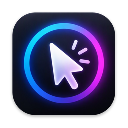

# Mousy

Mousy is a menu bar app for macOS that makes your screen easier to follow when you present, teach or record. It lights up your pointer, shows your clicks and keystrokes, and lets you draw on the screen.

**Download:** [tools.awhadi.online/mousy](https://tools.awhadi.online/mousy) · [Latest release](https://github.com/awhadi/mousy/releases/latest)

Requires macOS 13 or later. Works on Apple silicon and Intel Macs.

## Features

- **Spotlight.** Hold ⌘⌥ (or your own keys) to dim the screen except for a soft circle around the pointer. Scroll to resize it while it is lit, or keep it on all the time. Size, fade, darkness and tint are adjustable.
- **Pointer halo.** A ring or disc around the pointer, with your choice of border and fill colours and an optional pulse.
- **Click effects.** Aurora, water drop or particle ripples on every click, with separate colours for left and right clicks, or a random style each time.
- **Keystroke display.** Shows the shortcuts you press (or every key) in an on-screen bar, with dark, light or accent styles, a position, a size and a limit on how many show at once.
- **Laser pointer.** A glowing dot with a smooth trail that replaces the cursor.
- **Draw on screen.** Pen, line, arrow, rectangle and circle tools. Rough shapes snap to clean ones (lines, circles, ellipses, rectangles, squares, triangles, diamonds, pentagons and stars). Scroll to change the thickness, scroll sideways to feather the edge, and drawings clear themselves with a dust, smoke, shatter, sparkle, retract or fade animation.
- **Shortcuts.** Global keyboard shortcuts, or tap a modifier key several times, for every feature.

Everything is controlled from the menu bar icon and a native-style Settings window with search.

## Install

1. Download `Mousy.dmg` from the [latest release](https://github.com/awhadi/mousy/releases/latest/download/Mousy.dmg), open it and drag Mousy to Applications. (`Mousy.pkg` is a double-click installer that does the same.)
2. The first time you open it, macOS may warn that the developer is unidentified. Right-click Mousy, choose **Open**, then **Open** again.
3. Allow the permissions below when asked.

### Permissions

- **Input Monitoring** — needed for the keystroke display. Mousy only reads which keys are pressed to show them on screen; nothing is stored or sent anywhere.
- **Accessibility** — needed so a right-click can pass through while you draw.

macOS asks again after an update, because each version has a new signature.

## Updates

Mousy checks this page for a newer version once a day (you can turn that off in **About → Updates**) and can download and install it for you. The only thing it sends is the request to GitHub.

## Support

[support@awhadi.online](mailto:support@awhadi.online) · [tools.awhadi.online/mousy](https://tools.awhadi.online/mousy)

© 2026 AWHADI Studio. All rights reserved.
